# The `kwcapture` logo — directory guide and tool manual

Everything here builds the identity of [`kwcapture`](https://github.com/tjandrasg/kwcapture),
the fast Wayland/KWin screen-capture library: **two hand-drawn Inkscape sketches in, three
512×512 SVGs out**, plus a validator that can see geometry, paint *and* what a real renderer
paints, and a diagnostic that compares renderers against each other.

| file | job |
|---|---|
| [`AGENTS.md`](AGENTS.md) | the working set: rules, knobs, expected numbers, open items. **Read it before editing anything here** |
| [`AGENTS.old.md`](AGENTS.old.md) | the archive: superseded numbers, the full gotchas, the session log |
| [`LICENSE.md`](LICENSE.md) | artwork **CC BY 4.0**, tooling **MIT**, Inter **OFL-1.1** |
| `README.md` | this file: the structure and the manual |

Everything on this page was run on 2026-10-11 and the output is pasted from those runs, not
from memory — which is the house style for a reason you will meet in
[gotcha 18](AGENTS.md).

---

## 1. The three artefacts

> **`kwcapture-mark.svg` is the official logo of the project** (decided 2026-10-11). The
> generated icon set GitHub and every host actually consumes — social preview, avatar,
> favicon, PWA, Apple touch — is in [`icon/`](icon), §8. One other SVG ships: the full lockup,
> for large placements. The bare monogram is **a mode, not a file** (§4.2) — it was deleted on
> 2026-10-11, on the owner's ruling that it is unofficial and historical.

| | |
|---|---|
| 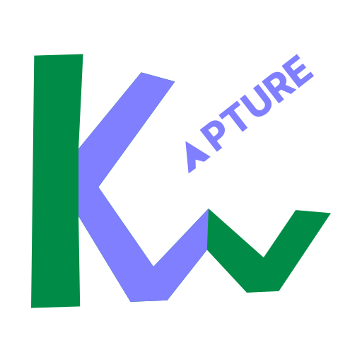 | **`kwcapture.svg`** — the logo. Original monogram + `APTURE` at −38°. `python3 gen_logo.py` |
| 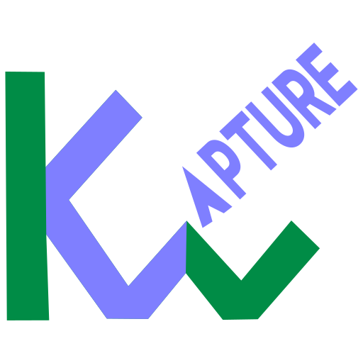 | **`kwcapture-mark.svg`** — the redrawn, geometric monogram + `APTURE` fitted into a helper box and stretched ×1.753 across the baseline. `python3 gen_logo.py --mark` |
| 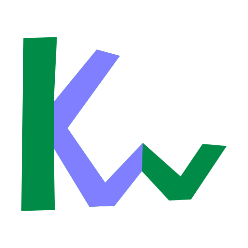 | **the monogram**, `--monogram --out PATH` — two-tone, no pointer, no type. A **mode** and a measurement in the ladder below, **not an artefact and not an icon**: `logo/kwcapture-mono.svg` was deleted 2026-10-11 (unofficial and historical, the owner's ruling), and the shipped icon is `kwcapture-mark.svg` at every size (owner's rule, §8). `python3 gen_logo.py --monogram --out /tmp/mono.svg` |

Palette **P2**, the owner's decision of 2026-10-11: `#008c46` (the monogram half: the K's stem
and the W) and `#7f7fff` (the word half: the C, the pointer-A, `PTURE`). It replaced `#00ac4e`
and `#0000ff`, and the reason is arithmetic rather than taste — **each half now clears the WCAG
3:1 non-text floor on both grounds**, 4.34 / 4.36 green and 3.29 / 5.75 blue on white and on
GitHub dark `#0d1117`, where the old blue managed **2.20** on dark. The table, the trade it
makes and the command that re-measures all of it (`logo/contrast_report.py`) are in §8. Both
flat, no gradient since 2026-10-10 — `--classic` brings the old gradient back. Geometry, the
fit and THE RULE did not move: P2 is paint, and the diff against the previous commit is
colour strings and nothing else.

## 2. The one idea you need first

The mark spells **CAPTURE**, and only one third of it is type:

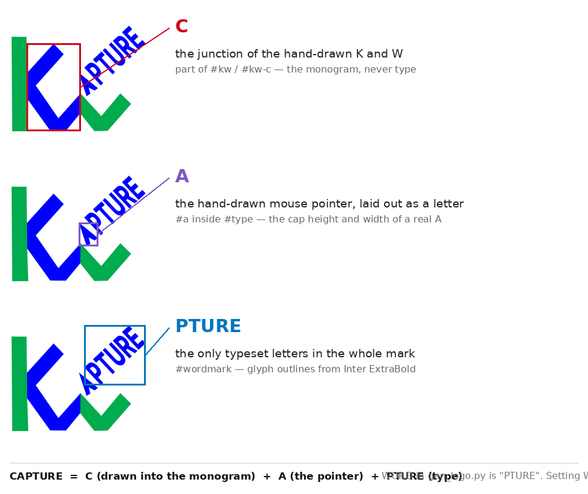

```
  C     <-  the junction of the hand-drawn K and W   (#kw / #kw-c, the monogram)
  A     <-  the hand-drawn mouse pointer             (#a, laid out as a letter)
  PTURE <-  the only typeset letters                 (#wordmark)
```

So `WORD = "PTURE"`. **Setting `WORD="CAPTURE"` renders `CACAPTURE`.** The blue bracket in
the K↔W junction is not decoration — it is the first letter, and it is the reason the mark is
called what it is. The C is also a *colour*: the stem is green so the bracket is the only blue
thing inside the monogram. (The C's legibility is still an open question with the owner — see
`AGENTS.md` §*Still open*.)

## 3. Directory structure

```
logo/
├── kwcapture-sketch.svg        INPUT   the original drawing (Inkscape, A4 mm): monogram + pointer
├── kwcapture-mark-sketch.svg   INPUT   the redrawn monogram + the black helper box
│
├── kwcapture.svg               OUTPUT  the logo            <- gen_logo.py
├── kwcapture-mark.svg          OUTPUT  the mark            <- gen_logo.py --mark
│       (two OUTPUT SVGs, not three: --monogram writes only where --out points it, because the
│        shipped kwcapture-mono.svg was deleted on 2026-10-11 — see §1 and §4.2)
│
├── gen_logo.py                 TOOL    sketch + knobs -> SVGs
├── contrast_report.py          TOOL    the WCAG numbers: palette vs white, vs #0d1117, split
├── validate_logo.py            TOOL    the gate: geometry, type, box, colour, render
├── render_agreement.py         TOOL    diagnostic: does each engine agree with the path data?
├── sync_package_icons.py       TOOL    icon/ -> ../kwcapture/icons/ (byte-for-byte) + --check
│
├── icon/                       SHIPPED  the official icon set (see icon/build.sh)
│   ├── kwcapture-mark-{1024,512,256,128,64,48,32,24,16}.png   ONE artwork: the mark, transparent
│   │       (16…512 are the hicolor sizes the package installs; 1024 is the docs master)
│   │       no monogram file lives here — see §8, "one artwork"
│   ├── favicon.ico  apple-touch-icon.png  pwa-{192,512}.png  maskable-512.png
│   ├── github-avatar-400.png  github-social-preview.png (1280×640)  contact.png (the sheet §8 shows)
│   ├── build.sh                        rebuilds the whole set in one command
│   ├── tiles.py  card.py  contact.py   Pillow builders; each verifies its own output
│
├── preview/                    DERIVED the documentation PNGs and the scripts that build them
│   ├── build.sh                        one command rebuilds every image on this page
│   ├── anatomy.py                      the figure in §2
│   ├── kwcapture-512.png  kwcapture-mark-512.png  kwcapture-mono-512.png
│   ├── sketch-source-512.png  sketch-mark-source-512.png
│   ├── ladder-kwcapture.png  ladder-mono.png  ladder-icon.png
│   ├── variants-type.png  variants-paint.png
│   ├── on-dark.png                     msvg-rotate-bug.png
│
├── AGENTS.md      the rules          ├── README.md        this file
├── AGENTS.old.md  the archive        └── LICENSE.md       what you may do with it
│
├── *.jsonl                TRANSIENT  session transcripts — gitignored, personal data, never
│                                      commit, never read whole (§6 of LICENSE.md, and
│                                      *Reading the transcript* in AGENTS.md)
└── __pycache__/           IGNORED    validate_logo.py imports gen_logo to reuse its geometry
```

The dataflow is a straight line — inputs on the left, the gate on the right. The helper box is
*read and then dropped*, so it appears in no output:

```
kwcapture-sketch.svg ─┬─> gen_logo.py ──────> kwcapture.svg   ─┬─> validate_logo.py ──> OK / FAIL
                      └─> gen_logo.py --monogram --out /tmp/… ┘             │
kwcapture-mark-sketch.svg ─> gen_logo.py --mark ─> …-mark.svg ──────────────┘
                    (the helper box is read, then dropped: it is not in any output)
```

### Inputs are sacred

`gen_logo.py` **never writes to a sketch**, and the SVGs are regenerated, not hand-edited:
every change belongs in a sketch or in a knob. If you "fix" a generated SVG by hand, the next
run erases it — and the validator will not notice, because it validates the file you replaced.

| what you want to change | where you change it |
|---|---|
| the monogram's shape, the pointer, the box | the relevant `*-sketch.svg`, in Inkscape |
| the letters, size, tilt, spacing, colours, stretch | a `gen_logo.py` flag (§4.5) |
| a rule about what is allowed | `validate_logo.py`, and then prove it fails (§5.4) |
| a number in the docs | run the tool and paste the real output |

## 4. `gen_logo.py` — the generator

`sketch + knobs → SVG`. It reads the drawing by **Inkscape path id**, extracts the glyph
outlines of `WORD` from a system font, lays the pointer out as a letter, and writes one file.

### 4.1 Requirements

| tool | needed by | without it |
|---|---|---|
| `python3` (3.9+; tested 3.14) | all three programs | — |
| `fontTools` | `gen_logo.py` | cannot extract glyph outlines (ImportError) |
| `numpy` | `validate_logo.py`, `render_agreement.py` | pairwise-distance and raster maths fail |
| `Pillow` | the render checks, `preview/anatomy.py` | render check skipped |
| `PyQt6.QtSvg` | `validate_logo.py` render check, `render_agreement.py` | engine reported missing, check skipped — **not silently passed** |
| ImageMagick (`magick`, internal MSVG coder) | same two | ditto |
| `inkscape` | `preview/build.sh`, `render_agreement.py` | previews cannot be rebuilt; engine skipped |
| `xmllint` | nothing (recommended) | you lose the cheapest syntax check there is |
| the font | `gen_logo.py` | `--font` any OTF/TTF; the shipped look is `Inter-ExtraBold.otf` |

Both the system `python3` and the repo's `.venv` have the Python pieces.

### 4.2 Modes

| command | writes | what it is |
|---|---|---|
| `python3 gen_logo.py` | `logo/kwcapture.svg` | original sketch, `PTURE` at −38°, cap 3.30 mm, padded to a 512² artboard |
| `python3 gen_logo.py --mark` | `logo/kwcapture-mark.svg` | mark sketch + `APTURE` **fitted into the helper box** drawn in that sketch (box read, then dropped), then stretched across the baseline |
| `python3 gen_logo.py --monogram --out PATH` | `PATH` — **`--out` is required** | monogram only — no pointer, no type |
| anything `--out PATH` | `PATH` | an experiment; the repo is untouched |

Default output paths differ per mode *on purpose*, so one mode can never clobber another's
artefact. `--monogram` has no default path since 2026-10-11 and **refuses to run** without an
explicit `--out`: a mode whose default re-creates a deleted artefact is how Round 12 shipped the
wrong drawing (`AGENTS.md` gotcha 38 — "an artefact that sits next to the approved artwork will
eventually be mistaken for the approved artwork").

```
$ python3 gen_logo.py --monogram
--monogram needs an explicit --out: there is no shipped kwcapture-mono.svg to write.
  a figure:  --monogram --out /tmp/mono.svg
  the mode is still here; the ARTEFACT is not. …
$ git log --diff-filter=D -- logo/kwcapture-mono.svg   # the file itself, if a figure ever needs it
```

### 4.3 What it prints, and why each line matters

```
$ python3 gen_logo.py
content bbox: (51.55, 99.83, 87.13, 129.96) (35.58 x 30.13 mm)   <- the drawing's own box, in mm
scale       : 11.918 px per mm                                   <- the mm->px map of the artboard
word        : 'PTURE'                                            <- THE RULE, printed back at you
'A' pointer : (69.87, 110.16, 72.84, 114.0)  ink 0.99 x cap wide <- the A is a real letter's width
'PTURE'     : (71.57, 99.83, 85.12, 111.43)
colour      : monogram #008c46, C + A + word #7f7fff
written     : /home/tjandra/way_scr_cap/logo/kwcapture.svg
```

`--mark` prints the fit it solved for, and one report nobody can eyeball — **the box taper**:

```
$ python3 gen_logo.py --mark
box         : base 24.917 x 7.786 mm at -43.12 deg
fit         : cap 4.310 mm, ink 24.917 mm long = 100.0% of the length, 55.4% of the height
anchor      : (71.641, 118.073) mm [center across, center along], inset=0.0 mm
height fill : x1.753 across the baseline: type ink 4.365 mm -> 7.652 mm = 98.3% of the box height
              (as tall as the drawn box allows: the ink touches its top edge at u=24.6 mm)
clearance   : 0.810 mm from the monogram after the stretch (was 0.792 mm)
box taper   : the drawn box is NOT a rectangle: the headroom over its base falls 7.920 -> 7.651 mm
              along the length (its top edge is -0.62 deg off parallel). Filling the MEAN height
              (x1.784) would have hung 0.133 mm = 1.6 px outside the far end, so the answer is x1.753
box         : dropped from the output (it was only a guide)
colour      : monogram #008c46, C + A + word #7f7fff
written     : /home/tjandra/way_scr_cap/logo/kwcapture-mark.svg
```

That `box taper` line exists because the obvious answer (fill the *mean* height, ×1.784) puts
type **1.6 px outside the hand-drawn box** at the end where the word is tallest and the box is
shortest — and a human cannot see 0.62° in a render. The generator prints its guide's
imperfection rather than leaving you to rediscover it.

```
$ python3 gen_logo.py --monogram --out /tmp/mono.svg
content bbox: (51.55, 99.83, 87.13, 129.96) (35.58 x 30.13 mm)
scale       : 11.918 px per mm
word        : (none)
colour      : monogram #008c46, C + A + word #7f7fff
written     : /tmp/mono.svg
```

The `colour` line is the palette read back, and it is the only place in the build's own output
that says what colour you asked for. It is also why the P2 recolour was checkable without
opening a single image: three modes, three `colour` lines, and the geometry lines either match
*Expected numbers* in `AGENTS.md` or they do not.

### 4.4 The write-guard: a variant needs `--out`

`--classic`, `--no-c-split`, `--c-paint` and friends change the **paint**, not the output path.
A variant run without `--out` used to overwrite the shipped logo and print a cheerful
`written:` line, while the file stayed valid XML, xmllint-clean and geometrically perfect.
That trap is now closed **by the tool**, which diffs every knob against argparse's own
defaults:

```
$ python3 gen_logo.py --classic
refusing to overwrite the shipped kwcapture.svg: this run deviates from the shipped look
by --classic.
  write it somewhere else:  --out /tmp/kwcapture-variant.svg
  or, if you really mean to replace the shipped file:  --force
$ echo $?
1
```

Verified again when the palette changed (2026-10-11, P2) — exit 1 and `kwcapture.svg`
byte-identical afterwards, and the same guard fires for a *paint* knob:

```
$ python3 gen_logo.py --mark --green '#00ff00'
refusing to overwrite the shipped kwcapture-mark.svg: this run deviates from the shipped look
by --green #00ff00.
```

That matters more on a recolour than it looks: the way to regenerate the shipped files with a new
palette is to **change `GREEN`/`BLUE` in `gen_logo.py`** and re-run the plain commands, so the
artwork and the constants cannot disagree. Passing `--green/--blue` into a shipped path would
leave a file whose colour no generator on this machine reproduces. `--force` means *I intend to
replace the shipped artefact*. The default paths of the modes are still fine for the shipped look
— the guard only fires when a knob deviates from it.

### 4.5 Every flag

Typeset from `--help`, with the shipped value. **`--help` is not always right**: the
`--c-paint` description still says "`mask` (default) and solid render identically everywhere";
the default is `solid`, and MSVG paints **no C at all** through a mask. Trust §4.7 and
`AGENTS.md`, and fix the help text next time the file is edited (it is on the open list).

**Type & layout**

| flag | default | meaning |
|---|---|---|
| `--word` | `PTURE` | the typeset letters. **Never `CAPTURE`** (§2) |
| `--font` | `/usr/share/fonts/opentype/inter/Inter-ExtraBold.otf` | ExtraBold matches a very heavy monogram; Bold looked thin next to it |
| `--cap` | `3.30` mm | cap height of the type (the drawn letters were ~3.4 mm) |
| `--track` | `0.10` em | letter-spacing; the sketch was widely set |
| `--angle` | `−38.0`° | baseline tilt (the drawing's baseline is ≈ −38.9°) |
| `--canvas` / `--pad` | `512` / `44` px | artboard and padding on the constrained axis |
| `--free-baseline` | off | stop levelling the word's cap-top with the top of the K |
| `--no-a` | off | monogram + `PTURE`, drop the pointer |

**The A** (the pointer, treated as a letter)

| flag | default | meaning |
|---|---|---|
| `--a-size` | `1.00` × cap | height, measured **perpendicular to the baseline**. >1 reads as "big C, medium A, small PTURE" |
| `--a-width` | `1.00` × a real capital A | stretches the pointer **along the baseline** to the face's own A width (3.282 mm at this cap). Uniform scaling gives a 0.71×-wide, decorative A |
| `--a-gap` | `0.70` mm | the A→P gap along the baseline; 0.90 mm read as a word break |
| `--a-upright` | off | snap the pointer exactly perpendicular. It then reads as an **arrow**, not a letter. Kept only so nobody rediscovers it |

**Helper box / `--mark` mode**

| flag | default | meaning |
|---|---|---|
| `--mark` | off | fit mode |
| `--box` | the unique parallelogram | id of the helper box (`fit-box` by convention) |
| `--inset` | `0.0` mm | keep away from the box edges. Costs type size **and** fill: `0.25`→×1.731, `0.5`→×1.708, `1.0`→×1.660 (measured) |
| `--align` / `--along` | `auto` | placement across / along the box; `auto` optimises both. `top` is now *rejected* when it buys clearance by spilling over the box edge |
| `--min-clear` | `0.50` mm | floor on ink clearance to the monogram. The word shrinks rather than touching it: `0.9` → cap 4.273 mm, `1.5` → 4.065 mm (measured) |
| `--no-height-fill` | off | keep the type uniform; ~45% of the box height stays empty. Byte-identical to the pre-Round-9 mark |
| `--max-stretch` | `2.00` × | ceiling on the fill. A taste guard: the box wants 1.753 and is not stopped |
| `--no-recenter` | off | keep the sketched position instead of centring on the artboard |

**Colour**

| flag | default | meaning |
|---|---|---|
| `--green` | `#008c46` | the monogram half (K's stem + W). The balanced green of the four measured: 4.34 on white / 4.36 on `#0d1117` |
| `--blue` | `#7f7fff` | the word half (C + pointer-A + letters). 3.29 on white / **5.75** on `#0d1117` — the only single value measured that clears 3:1 on both grounds. Against the green it touches it is now **1.32:1**, so the C separates by **hue**, not lightness; `logo/contrast_report.py` prints both |
| `--c-paint {solid,mask,clip}` | `solid` | how the blue C is cut — see §4.7. **The `--help` text about this is wrong** |
| `--no-c-split` | off | flat green monogram, no blue C: the *control* for "is it the colour that makes the C read?" |
| `--classic` | off | the pre-2026-10-10 look: gradient monogram, no split, black type |

**I/O**

| flag | default | meaning |
|---|---|---|
| `--sketch` | `kwcapture-sketch.svg` (or the mark sketch with `--mark`) | **literal path**: resolved from your cwd, not from the script. See the trap below |
| `--out` | per mode | where to write |
| `--force` | off | let a deviating variant overwrite a shipped artefact |

**Two path traps.** The *defaults* are resolved from the script's own directory, so the
documented commands work from any cwd. `--sketch` and `--out` are literal:

```
$ cd logo && python3 gen_logo.py --monogram --sketch logo/kwcapture-mark-sketch.svg --out /tmp/m.svg
FileNotFoundError: [Errno 2] No such file or directory: 'logo/kwcapture-mark-sketch.svg'
$ cd logo && python3 gen_logo.py --monogram --sketch kwcapture-mark-sketch.svg --out /tmp/m.svg   # works
```

### 4.6 The knobs that change the design, as pictures

The type knob — how much the `APTURE` fills the box's height:

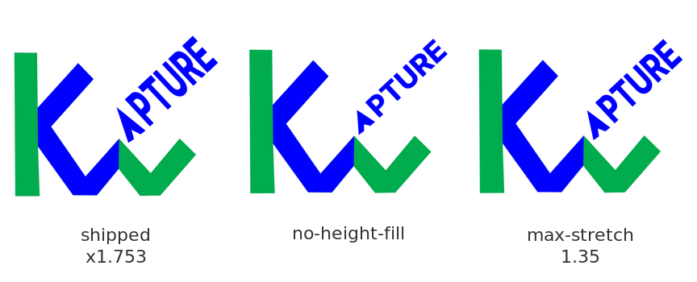

```bash
python3 gen_logo.py --mark                                  # shipped: x1.753
python3 gen_logo.py --mark --out /tmp/a.svg --no-height-fill # uniform, box height unused
python3 gen_logo.py --mark --out /tmp/b.svg --max-stretch 1.35
```

The paint knobs — and the control experiment for the C:

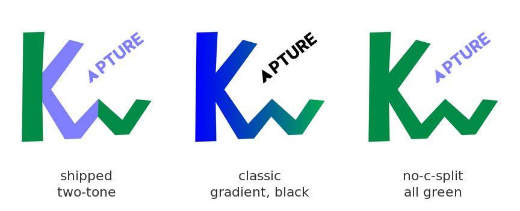

```bash
python3 gen_logo.py                      # shipped: KW green, Capture blue
python3 gen_logo.py --out /tmp/c.svg --classic     # gradient monogram, black type
python3 gen_logo.py --out /tmp/d.svg --no-c-split  # all-green monogram: does the C still read?
```

`--no-c-split` is the answer to a question the docs cannot answer: if the mark stops reading as
CAPTURE, is it the green stem splitting the monogram into `| <` + `W`? Show both to someone who
has never seen the sketch.

### 4.7 Why `--c-paint solid`, in one table

Three ways to paint the same C; **renderers disagree about all three**. Ink as % blue (truth:
38.4–39.5%, re-measured on palette P2 on 2026-10-11 with the validator's own hue classifier):

| renderer | `solid` | `mask` | `clip` |
|---|---|---|---|
| Inkscape / librsvg | 39.3% ✅ | 38.4% ✅ | 38.4% ✅ |
| **QtSvg** — Gwenview, Dolphin thumbnails, `QIcon` | 39.3% ✅ | 38.5% ✅ | **100% blue ❌** |
| **ImageMagick internal MSVG** | 39.5% ✅ | **0% blue ❌** | 39.3% ✅ |

The failure cells are renderer bugs, so they survive a recolour unchanged in kind; the numbers
beside them do not, which is why a table like this is re-measured per palette and not copied.

`clip` shipped for a day and looked **100% blue in every Qt viewer** because QtSvg ignores
`clip-path`; `mask` fixes Qt but MSVG hides a mask it does not parse. `solid` asks nothing of a
renderer — the C is its own path — and is legal only because the ring lies 100.0% inside the
monogram's ink, which the validator asserts. Try them; the validator will tell you:

```bash
python3 gen_logo.py --out /tmp/p.svg  --c-paint clip && python3 validate_logo.py /tmp/p.svg
python3 gen_logo.py --out /tmp/p2.svg --c-paint mask && python3 validate_logo.py /tmp/p2.svg
```

Both are **proven to fail**, in opposite directions, which is exactly why `solid` is the default:

```
clip:  render QtSvg (Gwenview, Dolphin, QIcon): green  0 blue 37731 -> 100.0% blue [NO GREEN]
       FAIL: QtSvg renders 100% blue: the green monogram is covered -- a cut-out this
             renderer ignores is in use (--c-paint solid emits neither clip nor mask)
mask:  render MSVG  (ImageMagick internal):     green 35088 blue   514 ->   1.4% blue [NO BLUE]
       FAIL: MSVG renders no blue at all: the C overlay is hidden -- unsupported cut-out
```

### 4.8 Feeding it a different sketch

`gen_logo.py` binds paths **by Inkscape id**: `path1` **or** `kw` = the monogram, `path10`
**or** `cursor`/`a` = the pointer. Everything else in the sketch is ignored (the letters come
from the font). A sketch with neither id now tells you which ids it looked for and which it
found, instead of `KeyError: 'path1'`. If you redraw and the vertex count is no longer **19**,
the generator **refuses**: the letter rings (`K_RING`/`W_RING`/`C_RING`) are vertex indices,
and re-numbering them is the owner's call, not a guess.

```bash
python3 gen_logo.py --monogram --sketch logo/kwcapture-mark-sketch.svg --out /tmp/mono-mark.svg
content bbox: (49.03, 100.35, 86.25, 129.8) (37.22 x 29.45 mm)   # the mark's monogram, not the original's
```

The two monograms are genuinely different drawings, which is why "which one is the identity" is
still open in `AGENTS.md`.

## 5. `validate_logo.py` — the gate

```bash
python3 logo/validate_logo.py                          # checks logo/kwcapture.svg
python3 logo/validate_logo.py logo/kwcapture-mark.svg   # the mark must be named explicitly
```

It parses the **emitted SVG**, applies every `transform` itself, and measures ink — so it
disagrees with the generator whenever the generator is wrong, which is the entire point.

### 5.1 The seven checks

| check | what it proves | how it can fail |
|---|---|---|
| **ink bounds** | where each element's ink actually is, per element (`#kw`, `#a`, `#wordmark`) | — (informational; feeds the rest) |
| **clearances** | no two elements collide (< 1.5 px = FAIL, < 3.0 px = "tight") | a collision, e.g. the A landing on the W |
| **artboard + centring** | ink inside 512², and centred (L/R and T/B within 1 px) | ink clipped by the artboard, or off-centre |
| **type check** | the pointer **is** a letter: height ≈ cap (±2 px), width 0.85–1.15 × cap, shared cap line, shared baseline — all measured **unstretched**, off `#type` | a silently wrong `A_SIZE`/`A_WIDTH` (a projection bug once rendered 1.41× cap while the knob said 1.00) |
| **box check** | `#a` and `#wordmark` are inside the helper box, which is *not in the output*: re-read from `<name>-sketch.svg`, re-centring undone | > 1 px outside. **Skipped silently if there is no `-sketch.svg`** — read the line, not the exit code |
| **colour split** | the blue C is derived, not drawn: 5 assertions, incl. "≥95% of the ring lies on ink" and "0% of the stem's area is inside it" — the two that cannot agree with a wrong idea by construction | a ring that wanders into the counters, or an `#kw-c` whose `d` is not derived (a redraw in disguise) |
| **render** | rasterises the file with **QtSvg** and **ImageMagick MSVG** and requires both colours present in both — because every other check reads path data and therefore agrees with the generator | `--c-paint clip` → *QtSvg renders 100% blue*; `--c-paint mask` → *MSVG renders no blue at all* |

### 5.2 Real output — the mark (the fullest case)

```
$ python3 validate_logo.py logo/kwcapture-mark.svg
# kwcapture-mark.svg   artboard 512x512
  kw        ink  x    7.45 ..  451.08   y  100.97 ..  451.93   (1184 pts)
  a         ink  x  256.95 ..  327.62   y  234.36 ..  321.51   (60 pts)
  wordmark  ink  x  276.93 ..  504.55   y   60.06 ..  281.35   (561 pts)
  clearance kw        <-> a        :    9.68 px  [ok]
  clearance kw        <-> wordmark :   73.13 px  [ok]
  clearance a         <-> wordmark :   14.91 px  [ok]
  ink 7.5,60.1 -> 504.5,451.9   padding  L 7.5  R 7.5  T 60.1  B 60.1
  colour split (vs kwcapture-mark-sketch.svg): solid 10 pts == recomputed, 100.0% on ink,
                stem area 0.00% blue
                samples: stem 3/3 green, C 6/6 blue, W 3/3 green
  box check (vs kwcapture-mark-sketch.svg): closest ink -0.03 px from the box edge
                (positive = inside), tightest is #a
  type check, perpendicular to the -43 deg baseline:
    height fill x1.753 across the baseline (read off #type, along-baseline factor 1.0000);
    rules below measured unstretched
    A height  51.37 px   cap height  52.02 px   ratio 0.987
    A width   51.09 px   = 0.982 x cap  (a real capital A is ~0.95-1.00 x cap)
    cap line : A  346.70  word  346.68   (delta +0.01)
    baseline : A  436.75  word  437.88   (delta -0.64)
  render palette: green #008c46 / blue #7f7fff (read off gen_logo.py, not repeated here)
  render QtSvg   (Gwenview, Dolphin, QIcon): green  20460 blue  23315 ->  53.3% blue
  render MSVG    (ImageMagick internal): green  20796 blue  20625 ->  49.8% blue
  OK
```

The `render palette` line is new with the recolour and it is the reason the numbers are
trustworthy: the validator used to hard-code "a fill starting `#00a` is the green half", which was
true of `#00ac4e` and **false of `#008c46`** — on the recoloured files that check compared
nothing and still printed a clean result. It now reads both colours out of `gen_logo.py` and
classifies rendered pixels **by hue**, and it refuses to guess when it cannot find the palette
(`AGENTS.md` gotcha 30: the thing that reports is the thing nobody checks).

The `box check` line is the one to watch: **−0.03 px** means the A's tip sits essentially *on*
the box's leaning edge — inside, and exactly where "as large as possible" leaves you.

### 5.3 The other two artefacts

```
$ python3 validate_logo.py                       # kwcapture.svg
  ... ink 44.0,76.5 -> 468.0,435.6  padding L 44.0 R 44.0 T 76.5 B 76.4
  colour split (vs kwcapture-sketch.svg): solid 10 pts == recomputed, 100.0% on ink,
                stem area 0.00% blue;  samples: stem 3/3 green, C 6/6 blue, W 3/3 green
  (no "box check" line: kwcapture-sketch.svg has no helper box, so the check returns nothing)
  render QtSvg 44.0% blue | MSVG 44.8% blue
  OK

$ python3 gen_logo.py --monogram --out /tmp/mono.svg && python3 validate_logo.py /tmp/mono.svg
  kw        ink  x   44.00 ..  468.00   y   76.45 ..  435.56   (1164 pts)
  colour split ... stem area 0.00% blue; samples stem 3/3 green, C 6/6 blue, W 3/3 green
  render QtSvg 39.3% blue | MSVG 39.5% blue
  OK                          <- one element, so no clearances and no type check apply
```

Both colours present in both engines is the assertion; the percentage is a diagnostic. Every
number in these two blocks is palette-dependent, all of them were re-measured on 2026-10-11 after
the P2 recolour, and none of them moved the geometry: `ink`, `padding`, `clearances` and the type
check are byte-for-byte the numbers from before it, which is how a "paint-only" claim is checked
rather than asserted.

~0% of one colour in some renderer does **not** mean the logo is wrong — it means that renderer
is ignoring a feature (that is how `clip` and `mask` were found).

### 5.4 Exit codes, and how to trust any check here

| exit | meaning |
|---|---|
| `0` | everything printed OK |
| `1` | at least one FAIL, **or a check that crashed** — `run_check()` prints `CRASH in <name>` + traceback, counts it as a failure (a check that died proved nothing) and ends with `NOT A CLEAN RUN` |

The last line is deliberately unmistakable, because a bare traceback through `| tail -1` once
left a session with `TypeError: …` and nothing else to go on. **Never diagnose from the tail of
a pipe.**

A check that agrees with you is not a check — so before believing one, **make it fail**. The
over-stretch sabotage, run and verified today:

```bash
cd logo
cp kwcapture-mark.svg /tmp/mark-backup.svg
sed -i 's/scale(1 1.753)/scale(1 1.86)/' kwcapture-mark.svg
test "$(grep -c 'scale(1 1.86)' kwcapture-mark.svg)" = 1 && echo "assert changed: OK"
python3 validate_logo.py kwcapture-mark.svg
python3 gen_logo.py --mark            # restore; cmp against the backup: byte-identical
```

```
  box check (vs kwcapture-mark-sketch.svg): closest ink -7.71 px from the box edge
                (positive = inside), tightest is #wordmark
  FAIL: ink is 7.7 px OUTSIDE the helper box - the fit is wrong
  FAIL: artwork not centred (L/R 7.5/9.0, T/B 54.4/60.1)
  2 problem(s)
```

The along-baseline sabotage (`s/scale(1 1.753)/scale(1.1 1.753)/`, same in-place procedure) fails
three ways instead:

```
  FAIL: the height stretch also scales ALONG the baseline (x1.1000): only across is allowed,
        or the tracking moves
  FAIL: ink is outside the artboard
  FAIL: artwork not centred (L/R 7.5/-14.0, T/B 40.0/60.1)
```

Two traps, both met for real while writing this file:

* **Assert the sabotage applied.** My first attempt used `scale\(1 1.753\)` in a BRE, matched
  nothing, changed nothing — and the validator cheerfully printed `OK` for a file I believed was
  sabotaged. That is gotcha 24's `assert changed` lesson, paid for a second time in a
  documentation round.
* **The box check finds its sketch by filename** (`<stem>-sketch.svg`, next to the *script*).
  Sabotage a copy at `/tmp/sab1.svg` and you get **no box-check line at all** — the file has no
  sketch, so containment is silently skipped and only the centring check catches the same bug.
  Sabotage **in place**, or accept that the sharpest check is the one you are not running.

### 5.5 The flake: re-run before you believe a crash

`box_check` → `gen_logo.find_box` → `convex_hull` crashes **intermittently** with errors its
source cannot produce — `TypeError: '<=' not supported between instances of 'float' and 'list'`
(where `tol` is a local float), or `IndexError: list index out of range`. Measured today:
**2/5, then 0/12, then 2/40** validator runs; also reproduced in a 70-line extract with **no
numpy and no fontTools**, and once as a hard
`Fatal Python error: _PyEval_EvalFrameDefault: Executing a cache.` — which no correct Python
program can cause. Bursty, not steady, which is why it survived three sessions as
"unreproducible".

Practical rules (full story, gotcha 29 in `AGENTS.md`):

* **Re-run.** One crash is not a finding, and one clean run is not either. `for i in {1..20}`.
* **Do not "fix" `convex_hull`** — the operands the message names cannot be built there. A
  retry wrapper would launder a machine fault into a passing build.
* Three message shapes were seen today, in three different checks — `TypeError: '<=' not
  supported between instances of 'float' and 'list'`, `IndexError: list index out of range`
  (both in `box_check`) and `TypeError: 'list' object cannot be interpreted as an integer` (in
  `colour_check`, 1/25 runs). Same fault, different costume: the message tells you about the
  *interpreter*, not about your code.
* Suspects, measured but unproven: a global `LD_PRELOAD=libgtk-nocsd.so.0`, and non-ECC RAM.
* Same family, quieter: one run printed `stem area 0.03% blue` where 310 other runs print
  `0.00%`. Identical input, different number, and it sits under the threshold — treat a marginal
  number as "re-run", not as evidence.

## 6. `render_agreement.py` — the diagnostic (it exits 1 on purpose)

```bash
python3 logo/render_agreement.py                     # the three artefacts
python3 logo/render_agreement.py --tol 4 logo/foo.svg # custom tolerance
```

`validate_logo.py`'s render check asks each engine *whether both colours appear*. It cannot see
**where** they were painted. This tool asks the sharper question: per engine, per colour, what
is the ink box, and does it match the box the **path data** implies (computed here from the
same path data, with every `transform` applied by hand)? An engine that disagrees has a
`transform` bug, not a colour bug.

```
$ python3 logo/render_agreement.py
# kwcapture.svg   artboard 512x512   (tolerance 2 px)
  green  path data says   44,  76.. 468, 436
    inkscape     44,  76.. 467, 435  ok
    qt           44,  76.. 467, 435  ok
    msvg         44,  76.. 468, 436  ok
  blue   path data says  111,  76.. 444, 427
    inkscape    111,  76.. 443, 426  ok
    qt          111,  76.. 443, 426  ok
    msvg        111, 102.. 468, 427  OFF BY 26 px
# kwcapture-mark.svg
  blue   path data says   64,  60.. 505, 450
    inkscape     64,  60.. 504, 449  ok
    qt           64,  60.. 504, 449  ok
    msvg         65, 127.. 511, 450  OFF BY 67 px
# the monogram, rendered from the MODE into a temp dir ... all ok   <- no rotate() in it

3 file(s) compared against the path data.  2 engine/path disagreement(s) -- see the OFF lines above
(the MSVG rotate() disagreements on the two lockups are gotcha 27, open, and this tool exits 1
until the owner decides it: a run that reports FEWER disagreements than that is a run that
stopped looking.)
$ echo $?
1
```

Three files compared, and only two of them are in the repo: the monogram is generated into a
temp directory with `--monogram --out` and compared there, exactly like the figures in
`preview/`. It is the control that proves MSVG's problem is `rotate()` — the monogram has none
and every engine agrees on it to 1 px.

**Exit 1 is the finding, not a failure of the build.** It stays non-fatal on purpose: making it
a gate would redden the shipped files over a third-party bug, and the fix is the owner's call
(`AGENTS.md` §*Still open*: emit a second, transform-free `kwcapture-flat.svg` for pipelines
using bare ImageMagick — compatibility without spending an invariant).

What it looks like, same files, two engines:

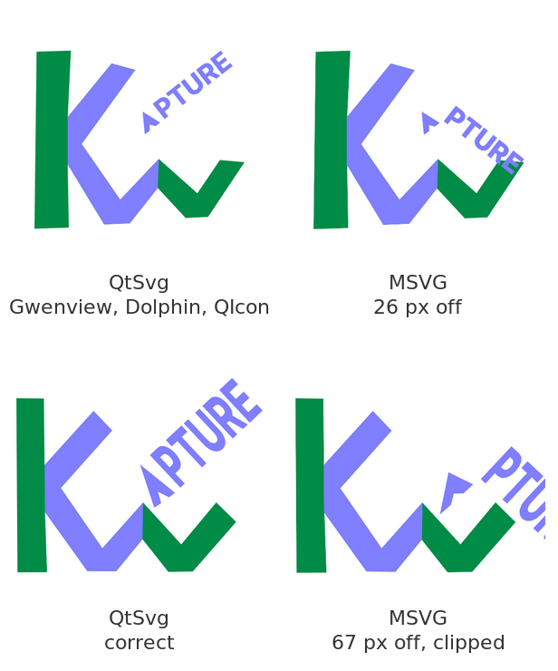

MSVG is wrong **exactly where a `rotate()` is involved** and exact on the mono, which has none.
Ruled out by measurement, not opinion: the argument separator, the transform *chain*, and
`rotate()` nested under a `scale()`. Baking the transforms into the path data *does* fix it —
which also proves the disagreement is about `transform`. Practical reach: ImageMagick **without**
a `librsvg` delegate (many servers and upload pipelines) renders the wordmark wrong; KDE,
Inkscape and browsers are fine, and `apt install librsvg2-bin` gives ImageMagick a delegate.

## 7. Making images: PNG, ICO, and the size ladder

One command rebuilds every image on this page (the exact commands are inside it):

```bash
bash logo/preview/build.sh
```

Individually:

```bash
inkscape logo/kwcapture.svg -o logo/preview/kwcapture-512.png -b white -w 512 -h 512
inkscape logo/kwcapture-mark.svg -o logo/preview/kwcapture-mark-512.png -b white -w 512 -h 512
# the monogram, for the figures: a MODE rendered into a temp file, never a file in logo/
python3 logo/gen_logo.py --monogram --out /tmp/mono.svg && \
  inkscape /tmp/mono.svg -o logo/preview/kwcapture-mono-512.png -b white -w 512 -h 512
# the inputs, as Inkscape sees them: the helper box is visible here, and only here
inkscape logo/kwcapture-sketch.svg      -o logo/preview/sketch-source-512.png      -b white -w 512 -h 512
inkscape logo/kwcapture-mark-sketch.svg -o logo/preview/sketch-mark-source-512.png -b white -w 512 -h 512
```

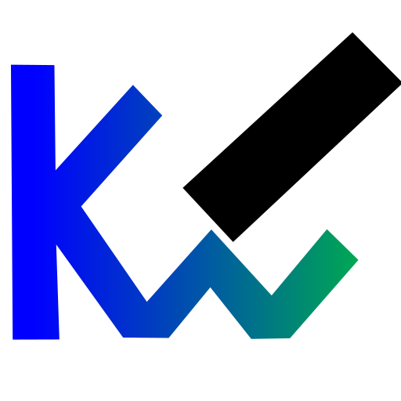

*`kwcapture-mark-sketch.svg`: the redrawn monogram and the black helper box. The box is read by
`--mark` and never emitted — this render is the only place you can see what the fitter was
given.*

### The ladder: where the word stops working

```bash
python3 logo/gen_logo.py --monogram --out /tmp/mono.svg          # the mode, into /tmp
for n in 512 256 128 64 32; do
  inkscape logo/kwcapture.svg -o /tmp/full-$n.png -b white -w $n -h $n
  inkscape /tmp/mono.svg      -o /tmp/mono-$n.png -b white -w $n -h $n
done
```

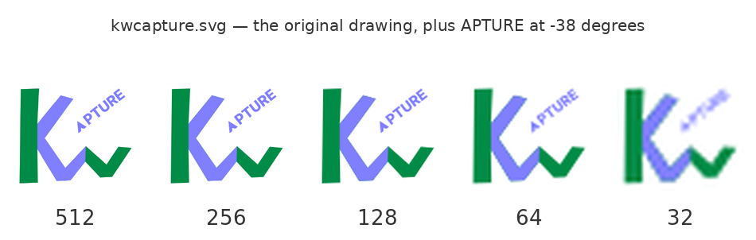

`APTURE` stops being readable around **128 px** and is gone by 64 — that is not a bug in the
render, and since 2026-10-11 it is a *documented consequence* rather than a reason to substitute
a different drawing. Read it as the measurement it is:

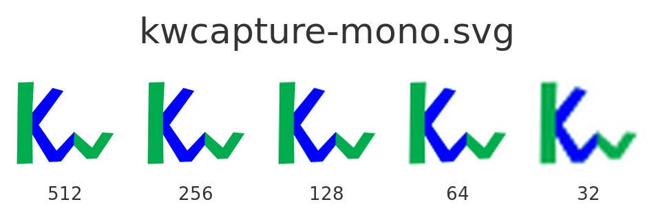

| size | use |
|---|---|
| ≥ 256 px | `kwcapture.svg` (docs header, README, og image) |
| 128–256 px | `kwcapture-mark.svg` — the box-fitted type survives here best |
| ≤ 64 px | still `kwcapture-mark.svg` — the owner's rule (§8): one artwork, resized. The word is mush there and that is accepted; a monogram is **not** a small-size fallback |

### Icons

The **shipped** icon set — every size, plus tiles, `.ico`, avatar and social card, with the
reasoning — is §8; `bash logo/icon/build.sh` makes all of it. These two one-liners are the
throwaway versions, for an icon you want in `/tmp` in ten seconds:

```bash
# favicon / app icon — ImageMagick does the sizes; -background none keeps it transparent
magick -background none logo/kwcapture-mark.svg \
       -define icon:auto-resize=16,32,48,64,128,256 /tmp/kwcapture.ico
# social card: 1200x630 exactly (note -extent: -resize alone would give you 630x630)
magick -background none logo/kwcapture.svg -resize 630x630 \
       -extent 1200x630 -gravity center /tmp/og.png
```

Verified: the `.ico` comes out with all six sizes; the card is 1200×630. **Do not ask Inkscape
for an `.ico`** — it exits 0 and writes no file at all. An icon that silently does not exist is
the same species of bug as a check that silently does not run: the exit code is not the result.

Build them from the **same** drawing the header uses. Since 2026-10-11 that is not advice but a
rule with a check behind it: the icon of kwcapture is `kwcapture-mark.svg`, the permitted
transforms are resize and re-render, and `tests/test_icons.py` asserts every file shipped inside
the package is that mark (`AGENTS.md` still carries the "two monograms" item as design history,
not as an icon menu).

## 8. The official icon set — `icon/`

On 2026-10-11 the owner chose **`kwcapture-mark.svg`** as the logo of the project — and, in the
same breath, as its **icon**. So `icon/` holds that one artwork in the formats hosts ask for (a
`.ico`, Apple touch, PWA, GitHub's avatar and social card), plus its renders at every size the
freedesktop theme declares, and one command rebuilds all of them:

> **One artwork, two grounds, many sizes — that is the whole set.** No monogram, no "glyph form",
> no crop invented here. The only permitted transformations are **resize** and **re-render**. An
> earlier revision of this directory shipped `glyph-*.png` (the mark's monogram) as the small-size
> icon because `APTURE` is mush below ~64 px; that decision belonged to the owner, not to a build
> script, and it is reverted. The files are deleted (`git log --diff-filter=D -- logo/icon/`
> recovers them if a *document* ever needs the comparison).


```bash
cd logo && bash icon/build.sh      # inkscape + ImageMagick + Pillow; writes into icon/ only
```

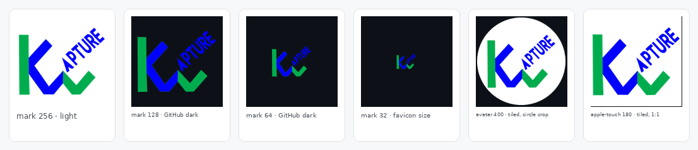

| file | what it is for | built by |
|---|---|---|
| `../kwcapture-mark.svg` | **the logo and the icon** — the source of everything below, and copied verbatim into the package as the scalable entry | `gen_logo.py --mark` |
| `kwcapture-mark-{1024,512,256,128}.png` | README headers, docs, og images — anywhere ≥ 128 px | `icon/build.sh` |
| `kwcapture-mark-{64,48,32,24,16}.png` | the small sizes — **the same mark**, and the eight PNGs (16…512) that ship inside the Python package (*Into the Python package*, below) | `icon/build.sh` |
| `favicon.ico` (16/24/32/48/64) | browsers that still ask for `.ico` | `icon/build.sh` |
| `apple-touch-icon.png` (180, rounded) | iOS home screen (it masks again, which is fine) | `icon/tiles.py` |
| `pwa-192.png`, `pwa-512.png`, `maskable-512.png` | a PWA manifest; `maskable-512` keeps the 80 % safe zone | `icon/tiles.py` |
| `github-avatar-400.png` | **GitHub avatar** — org/profile image. The mark at 79 % of the tile, so GitHub's circular mask clips **zero** ink | `icon/tiles.py` |
| `github-social-preview.png` | **GitHub social preview**, 1280×640, 84 871 B (the limit is 1 MB) | `icon/card.py` |
| `contact.png` | the review sheet above | `icon/contact.py` |

Nothing here is hand-made, and nothing here is a second drawing either: `build.sh` ends by
re-rendering `../kwcapture-mark.svg` at all nine sizes and comparing **pixels** against the files
it just built, so a hand-swapped or monogram file fails the build. Each Python builder verifies
its own output too: `tiles.py` fails on a blank or greyscale tile *and* on any tile whose artwork
the host's mask would clip, `card.py` measures every string with `font.getlength()` and asserts
nothing reached the right edge. That last assert is not decoration — the first `card.py`
hard-coded font sizes and printed `wrote … 1280x640` over a card whose tagline ran off the
canvas. **A success message is not a check** (gotcha 24, met a third time in this round).

### One artwork, two grounds — and what that costs

**The word dies at 64 px.** Rendered, not guessed (`bash preview/build.sh` makes this figure —
the bottom row is the monogram, shown as the *measurement*, and it is not in the shipped set):

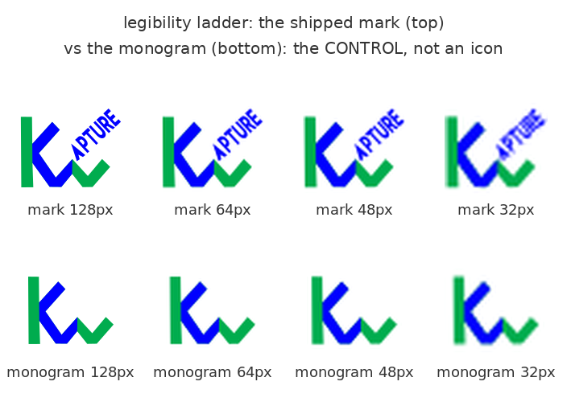

`APTURE` is legible at 128 px, marginal at 64 — you can just resolve it — and mush at 48 and
below. What the set does about that is **nothing**: it ships the mark anyway, because the owner
chose the mark and the only permitted transforms are resize and re-render. The honest statement
of the trade is: at 16 px the icon reads as the monogram with an unreadable tail, which is a
branding cost the project accepts rather than one a build script may cover up by substituting a
different drawing. (The previous revision did exactly that, and the files it shipped —
`glyph-*.png`, `kwcapture-mark-mono.svg` — are deleted here; `git log --diff-filter=D --
logo/icon/` finds them if a document ever needs the comparison again.)

**Both halves clear both grounds.** That sentence used to be false, and the paragraph here used to
read *"no ground wins both colours"* — true of the palette it measured, written as though it were
a law about marks. It was not a law; it was one pair of hex values. WCAG relative luminance, as
of palette **P2** (2026-10-11), printed by `python3 logo/contrast_report.py`, which reads the
colours out of `gen_logo.py` so the table cannot drift from the artwork:

| | against GitHub dark `#0d1117` | against white |
|---|---|---|
| blue `#7f7fff` — the C, the A, `PTURE` | 5.75:1 | 3.29:1 |
| green `#008c46` — the KW | 4.36:1 | 4.34:1 |

Nothing is bolded, because nothing falls short of the 3:1 floor for graphical objects (WCAG
1.4.11). The same table on the palette it replaced had **two** short cells, one per ground — blue
`#0000ff` at **2.20:1** on dark, green `#00ac4e` at **3.00:1** on white — and the dark one is the
finding this folder carried since Round 10, which is what `preview/on-dark.png` was built to
show. Its caption is generated from the constants and the build **refuses to draw the figure** if
a cell drops back under the floor.

What the old paragraph got right, and what it overstated, is the arithmetic. A colour clears 3:1
against white only if its relative luminance is at most **0.3000**, and against `#0d1117` only if
at least **0.1164** — so the set of "legal on both grounds" colours is the window
**[0.1164, 0.3000]**, and it is not empty: both P2 halves sit inside it (L 0.1920 and 0.2691).
The window is narrow, though, and everything inside it is close together: two colours in it can
separate by at most **2.10:1** in lightness. So *"both halves legal on both grounds"* and *"a loud
two-tone split"* are in tension by arithmetic, not by taste, and P2 is the trade made on purpose:
it spends split strength — the old pair was **2.87:1** apart, P2 is **1.32:1** — and buys
everything else. The C still reads because it differs from the green in **hue** (240° against the
green's 150°) rather than in value. That is a dependency worth knowing rather than admiring: in a
greyscale print, or any pipeline that loses saturation, the two halves become near-identical and
the first letter of the word goes with the distinction. `contrast_report.py` prints the
dichromatic estimate too (ΔE76 117 / 116 / 33 for protan / deuteran / tritan, ratios 1.15 / 1.27 /
1.08) — an LMS-space estimate of a rough topic, a smoke test and not a person.

The mark *is* visible on dark — the strokes are thick and `contact.png` shows it — which is why
the stronger claim this section first carried ("a transparent icon loses the blue entirely") was
struck from `build.sh` after the dark contact sheet disproved it. Light tiles remain what iOS,
PWA and avatar slots want anyway, and every tile in `icon/` composites on white; the transparent
renders stay in the set for hosts that want them.

**The masks, measured instead of feared.** The old reason for shipping a monogram was "GitHub
crops avatars to a circle and a circular crop amputates `TURE`". Both halves of that were
measured on 2026-10-11, and the answer is a **scale**, not a second logo:

| the mark on a 400 px tile | ink lost to the inscribed circle |
|---|---|
| full bleed (400 px) | **4 015 px**, worst 45.6 px beyond the circle |
| 81 % (324 px) | 3 px of resampling halo, 0.9 px overshoot |
| **79 % (316 px)** | **0 px** — nothing clipped |

The lockup's ink is wide but its corners are empty, so it fits a circle better than its bounding
box suggests (the box alone implies 63 %). `tiles.py` uses `FIT = 0.79` for every masked tile and
**fails the build** if any ink lands under the mask, so if the mark, the resampler or the tile
maths ever change, this stops being true loudly. `maskable-512` is additionally capped by its
80 % safe zone. `contact.png` shows the avatar with the circle applied — review it, don't reason
about filenames.

### Setting them on GitHub

The repository's picture is its **social preview**, and that image is a **web-UI setting** — the
APIs do not expose it, which was probed with an admin token on 2026-10-11 rather than assumed:
`POST /repos/tjandrasg/kwcapture/social_preview` → **404**, GraphQL's 262 mutations contain
**zero** matching `avatar|social|preview|image|upload`, and `github.com/settings/profile` with
that same token → **302 to `/login`** (the web app runs on a cookie session; a PAT is not one).
So no script in this repo can set it, and none pretends to (gotcha 34). Two uploads, both from
`logo/icon/`:

1. **Social preview — DONE 2026-10-11.** It was set by hand at
   <https://github.com/tjandrasg/kwcapture/settings> → *Social preview* → **Edit image** →
   `github-social-preview.png` (1280×640), and it is verified live (the query below): `true`, a
   `repository-images.githubusercontent.com/…` URL, and the bytes that URL serves are the file in
   this folder. If the mark is ever recoloured, **this is a second thing to re-do**, because GitHub
   stores the upload — it does not re-render it from the repo.
2. **Profile picture — optional, and there is no org.** `tjandrasg` is a **personal** account
   (`repository { owner { __typename } }` → `User`), so there is no organisation avatar and a
   *repository* has no avatar of its own either: a repository's picture **is** its social preview,
   which is item 1. `github-avatar-400.png` exists in case the mark is wanted as the *user's*
   profile picture — that is *Settings → Profile → Profile picture*, a different surface, not part
   of this repository's settings and not covered by any check here.

**Checking whether the upload landed** — the API cannot write the image, but it can read it, so
the click is verifiable without a browser:

```bash
curl -s -X POST https://api.github.com/graphql -H "Authorization: Bearer $TOKEN" \
  -H "Content-Type: application/json" -d '{"query":"{ repository(owner:\"tjandrasg\",name:\"kwcapture\") { usesCustomOpenGraphImage openGraphImageUrl } }"}'
```

**Measured 2026-10-11 after the click: `usesCustomOpenGraphImage` → `true`**, and
`openGraphImageUrl` → `https://repository-images.githubusercontent.com/1406948211/dc44cc05-…`.
Before the click it was `false` with GitHub's generated `opengraph.githubassets.com/…` placeholder,
which is also what this query will show again if the image is ever removed.

The check does not stop at the flag: fetch the URL and compare **pixels** with the file that was
uploaded, because `true` only proves *an* image, not *this* one.

```bash
curl -sL -o /tmp/og_live.png "$(… openGraphImageUrl …)"      # 200, image/png
magick identify /tmp/og_live.png logo/icon/github-social-preview.png   # 1280x640, same bytes
# and a per-pixel comparison (PIL): 0 of 51 681 sampled pixels differ
```

Measured that way on 2026-10-11, against the palette in force when the click happened: both
**1280×640, 84 565 B**, and **0 differing sampled pixels** — GitHub stored the artwork unchanged.
That is the whole loop: click, query, fetch, compare.

**And it needs doing again, because the palette changed the same day.** Palette P2 (see the table
above) rewrote `icon/github-social-preview.png` — now **84 871 B** — while GitHub keeps serving the
upload it was given, so the live card is still `#0000ff`-and-`#00ac4e`. Re-run the loop after the
re-upload: a `true` flag with the old pixels is precisely the case the pixel comparison exists to
catch. `icon/github-avatar-400.png` (P2: **25 293 B**) is the same story if it is used as the user
profile picture.

What *is* automatic is the README header: [`../README.md`](../README.md) opens with
`logo/icon/kwcapture-mark-256.png`, written as an absolute `raw.githubusercontent.com` URL on
purpose, because PyPI renders the same README and does not resolve repo-relative image paths.

### Re-running after a logo change

```bash
cd logo
python3 gen_logo.py --mark && python3 validate_logo.py kwcapture-mark.svg
bash icon/build.sh          # every size, tile, .ico, card, contact sheet + the one-artwork guard
python3 ../logo/sync_package_icons.py    # and into the package (see below)
python3 contrast_report.py  # the WCAG table; --min makes it a gate on a recolour
```

If the change was a **recolour**, three extra things are true and none of them is optional:

1. Regenerate from the **constants** in `gen_logo.py` (`GREEN`, `BLUE`), never by passing
   `--green`/`--blue` at a shipped path — the guard refuses, correctly, because the artwork has to
   stay reproducible from generator state.
2. Prove the change is paint-only before reviewing a single image: `diff` the SVGs against the
   previous commit with the hexes stripped, and it must come out **empty**
   (`diff <(git show HEAD:logo/kwcapture-mark.svg | sed -E 's/#[0-9a-fA-F]{6}//g') \
           <(sed -E 's/#[0-9a-fA-F]{6}//g' logo/kwcapture-mark.svg)`).
   Every *geometry* number in `AGENTS.md` §*Expected numbers* should also be unchanged; if one
   moved, the recolour was not a recolour.
3. Re-measure the things that are paint-dependent and nothing else carries: the tile `FIT` headroom
   (`python3 icon/tiles.py --sweep` — antialiasing is ink, and ink colour is what antialiasing
   blends), the byte sizes, the sha256s, the `--c-paint` matrix, and the GitHub upload (above).
   Run `bash icon/build.sh` **after** the sweep and before you commit, then `git status`: the sweep
   prints a measurement and writes nothing, but if a rebuild still dirties `icon/` then something
   outside the build wrote those files — which is exactly how a palette round nearly committed tiles
   whose bytes were not the build's (`AGENTS.md`, gotcha 41).

`build.sh` has no monogram step any more — deliberately: if you need a monogram for a *figure*,
render one to `/tmp` with `gen_logo.py --monogram --sketch kwcapture-mark-sketch.svg`, which is
what `preview/build.sh` does for the ladder. Nothing monogram-shaped belongs in `icon/`.

Then open `icon/contact.png` and *look at it* before committing. The sheet is the review; the
exit codes only tell you the tools were awake.

### Into the Python package — `sync_package_icons.py`

The mark does not stop in this directory. The package whose desktop entry needs an icon ships it,
and one command is the **only** sanctioned writer of that tree:

```bash
python3 logo/sync_package_icons.py            # icon/ -> ../kwcapture/icons/ (+ COPYING.md)
python3 logo/sync_package_icons.py --check    # verify only; exit 1 on any drift
make icons                                    # the same, through the Makefile
```

| in `logo/icon/` | → `../kwcapture/icons/` | installed by `kwcapture install-desktop` into |
|---|---|---|
| `kwcapture-mark-<N>.png`, N = 16 24 32 48 64 128 256 512 | `hicolor/<N>x<N>/apps/kwcapture.png` | `$XDG_DATA_HOME/icons/hicolor/<N>x<N>/apps/` |
| `../kwcapture-mark.svg` (not in `icon/` — the logo itself) | `hicolor/scalable/apps/kwcapture.svg` | the same, scalable |
| — | `COPYING.md` | nowhere: it is licence text for the tree, not an icon |

Three rules make that copy worth trusting, and each of them is a check rather than an intention:

* **a copy, never a resample, and never a different drawing** — the bytes in the wheel are the
  bytes reviewed in `contact.png`; the sizes exist because
  `/usr/share/icons/hicolor/index.theme` declares those directories, which is why the mark is now
  rendered at 16/24/32/48/64 as well as from 128 up (`AGENTS.md` gotcha 37). What they are a
  render *of* is fixed too: `plan()` reads `kwcapture-mark-<N>.png` and `kwcapture-mark.svg`, and
  `tests/test_icons.py` compares the shipped scalable SVG against `logo/kwcapture-mark.svg` byte
  for byte, so substituting artwork is caught rather than trusted;
* **one source for the size list** — it is read out of `kwcapture/_icons.py` itself, so the
  generator and the installer cannot disagree about which sizes exist;
* **`--check` runs somewhere other than the machine that made the copy** — `tests/test_icons.py`
  runs it and that suite is a CI step, so a re-rendered mark with a stale package copy is a failed
  build rather than somebody's outdated desktop icon (gotcha 36).

`COPYING.md` is generated too: **CC BY 4.0** for the pictures against MIT for the code
([`LICENSE.md`](LICENSE.md)), the attribution line the licence asks for, and the sha256 of the
source every file was copied from. `logo/` itself is deliberately **not** in the sdist — 1.5 MB on
this checkout, 1.1 MB of it generated review PNGs — so the `--check` is the bridge back to it.

What the user of the package sees is in the root [`../README.md`](../README.md) under *Brand icons*: `install-desktop` and
`setup` install these files, `--no-icons` skips them, `--uninstall` removes only files whose bytes
are still ours, and the entry's `Icon=` name is resolved per machine — a `;` fallback chain is not
parsed by GLib or by KService, so the name is chosen at write time instead.

## 9. Dark surfaces

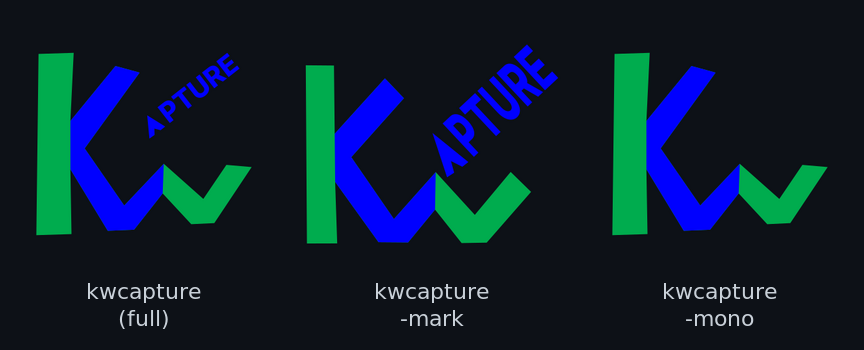

This figure used to be the evidence of a failure: the type was `#0000ff`, **2.20:1** on GitHub dark
`#0d1117`, under the WCAG 3:1 floor for graphical objects — better than the `#000000` it replaced
(1.11:1, effectively invisible) and still short of usable. **Palette P2 (2026-10-11) fixed the
failure**, so the figure now carries the measurement instead: green **4.36** and blue **5.75** on
`#0d1117`, **4.34 / 3.29** on white. Those four numbers are *not typed into the caption* —
`preview/build.sh` computes them from `gen_logo.py`'s constants via `contrast_report.py` and
**refuses to draw the figure** if any cell falls back under the floor, because a caption that has
gone stale is worse than no figure at all.

So there is no dark *problem* to solve, and no dark variant ships. If one is ever wanted, both
colours are mid-tones so a dark variant is two recolours, and the flags make it one line:

```bash
# what you see above: the shipped files composited on GitHub dark
inkscape logo/kwcapture.svg -o /tmp/dark-bg.png -b '#0d1117' -w 400 -h 400
# a real dark variant, if the owner decides to ship one
python3 gen_logo.py --out /tmp/dark.svg --blue '#4d8dff' --green '#3ddc84'
python3 validate_logo.py /tmp/dark.svg
```

Re-check the C against **its own** green when you do, and expect it to be close: on P2 the
blue-vs-green split is **1.32:1** by design (both halves are squeezed into the legal-on-both
luminance window, where 2.10:1 is the ceiling — §8 has the arithmetic), and prettier light blues
collapse toward 1.2, at which point the C dissolves into the W and the first letter of the word is
gone. On the old palette the same check read 2.87:1, which is the number P2 spent to buy the dark
grounds — `python3 logo/contrast_report.py '#00ac4e' '#0000ff'` prints it, so the comparison does
not depend on anybody remembering it.

## 10. A clean build, end to end

This is the exact sequence behind the "verified" claim at the top of `AGENTS.md`. Generating to
`/tmp` and `cmp`-ing proves regeneration is byte-identical without touching the repo:

```bash
cd ~/way_scr_cap/logo
for f in kwcapture kwcapture-mark; do cp $f.svg /tmp/$f.orig.svg; done   # the two shipped SVGs
python3 gen_logo.py               --out /tmp/t_full.svg
python3 gen_logo.py --mark        --out /tmp/t_mark.svg
python3 gen_logo.py --monogram    --out /tmp/t_mono.svg   # a mode, to a temp path: no cmp to
                                                          # a shipped file, because there isn't one
                                                          # (deleted 2026-10-11; --out is required)
cmp /tmp/t_full.svg /tmp/kwcapture.orig.svg        && echo full identical
cmp /tmp/t_mark.svg /tmp/kwcapture-mark.orig.svg   && echo mark identical
xmllint --noout *.svg
python3 validate_logo.py kwcapture-mark.svg     # OK
python3 validate_logo.py /tmp/t_mono.svg        # OK: one element, no clearances/type check
python3 validate_logo.py kwcapture.svg          # OK when box_check survives it (see 5.5)
python3 contrast_report.py                      # the WCAG table; exit 0 = every cell >= 3:1
python3 render_agreement.py                     # exit 1: MSVG off by 26 and 67 px. Expected.
```

Measured 2026-10-11 after palette P2: **2/2 byte-identical** (the two shipped SVGs), the monogram
mode rendering cleanly to `/tmp`, xmllint silent, all three validations OK, `contrast_report.py`
printing 4.34 / 4.36 / 3.29 / 5.75 and exiting 0, and `render_agreement.py` reporting the same two
MSVG numbers the docs carry — the finding survives a recolour, the tool that measures it had to be
fixed to say so (`AGENTS.md` gotcha 40).

And after a **recolour**, add the one command that proves nothing else moved:

```bash
cd ~/way_scr_cap
diff <(git show HEAD:logo/kwcapture-mark.svg | sed -E "s/#[0-9a-fA-F]{6}//g") \
     <(sed -E "s/#[0-9a-fA-F]{6}//g" logo/kwcapture-mark.svg)   # empty == paint only
```

The icon set is a second, separate build (`bash icon/build.sh`, §8): it re-reads the same SVGs,
cannot write outside `icon/`, and each of its builders verifies its own pixels. The package copy is
a third (`python3 logo/sync_package_icons.py --check`, §8): it verifies that what shipped is what
this directory produced.

## 11. Where to go next

| you want to | read |
|---|---|
| change anything at all | [`AGENTS.md`](AGENTS.md) — the rules, the knobs and why, the expected numbers, the 40 gotchas |
| know why a rule exists, or what was tried and rejected | [`AGENTS.old.md`](AGENTS.old.md) — full gotchas, the falsified numbers, the session log (Rounds 1–11) |
| ship an icon, an avatar or a social card | `icon/` — §8: one command (`bash icon/build.sh`), and the measurements behind every size |
| get the mark onto a desktop, or into the package | §8 *Into the Python package*: `sync_package_icons.py`, hicolor, and the `Icon=` findings in [`../AGENTS.md`](../AGENTS.md) |
| use, copy or recolour the artwork | [`LICENSE.md`](LICENSE.md) — CC BY 4.0 (artwork), MIT (tooling), trademarks **not** granted |
| the software the mark belongs to | [`../README.md`](../README.md) — `kwcapture`: ~40 fps Wayland capture for KDE Plasma |
